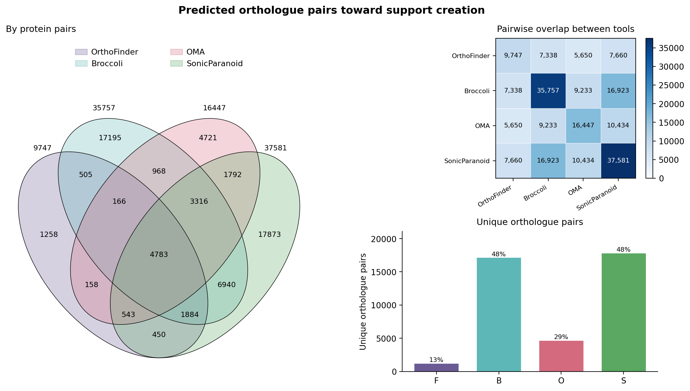

# SuppOrth

SuppOrth runs OrthoFinder, SonicParanoid2 and Broccoli on two or more protein
FASTA files, then combines their predictions into unique cross-species protein
pairs. Results from a separate OMA run can be included as a fourth prediction
set.

Each pair has a support count, one 0/1 column per tool, and alignment statistics
when a matching BLAST or DIAMOND hit is available. If two proteins in one species
are predicted to match one protein in another species, both pairs are retained.
Within-species pairs are excluded.

The predictors provide complementary methods: OrthoFinder uses gene-tree
reconciliation, Broccoli combines graph and phylogenetic inference, SonicParanoid2
uses similarity-based inference with domain analysis, and OMA uses evolutionary
distance consistency. Support counts record agreement between these methods;
they are not calibrated probabilities.

## Installation

Use an existing Python 3.10–3.12 interpreter to create an environment:

```sh
python3.10 -m venv .venv
source .venv/bin/activate
python -m pip install 'git+https://github.com/fma91/SuppOrth.git@stand_alone'
suppOrth install
suppOrth check
```

From a local checkout, use `python -m pip install .` instead of the Git command.

`suppOrth install` installs all three predictors sequentially from their upstream
repositories. OrthoFinder is pinned to `v2.5.5`, SonicParanoid2 to `2.0.9`, and
Broccoli to `v1.4.0`. SonicParanoid is compiled from its cloned source using pip.
A compiler toolchain is required for its extensions.

Installations are stored under `~/.supporth`. Set `SUPPORTH_HOME` to use another
location. Helper binaries already on `PATH` are linked into `~/.supporth/bin`;
available upstream releases are downloaded when needed. MAFFT and FastME must
already be installed or supplied with `--adopt`.

```sh
suppOrth install --adopt diamond=/path/to/diamond --adopt mafft=/path/to/mafft
suppOrth install --python /path/to/python3.10
suppOrth install --tools orthofinder --ref orthofinder=v2.5.5
```

OrthoFinder and Broccoli have private virtual environments. SonicParanoid uses a
private package directory with an existing interpreter. A conda-style interpreter
allows this SonicParanoid version to use the shared helper binaries; a different
interpreter may require its exact bundled binary versions. SuppOrth installs
packages with pip and does not install Python or modify the borrowed environment.

SonicParanoid also needs an indexed Pfam database. Installation prepares the
bundled profiles unless an existing database is supplied:

```sh
suppOrth install --pfam-db /path/to/profile_db
```

The database is checked before installation. Its files are hardlinked when
possible, or copied across filesystems. Preparing a new index can take several
hours and requires substantial disk space.

## Run

Pass FASTA files individually or provide a directory:

```sh
suppOrth run speciesA.faa speciesB.faa speciesC.faa -o results/ -t 8
suppOrth run -f proteomes/ -o results/ -t 8
```

Directory input accepts `.faa`, `.fa`, `.fasta`, `.pep` and `.fas`, including gzip
files. Only files directly inside the directory are used. Each predictor runs
once on the complete set of proteomes. The tools run sequentially and manage
their own parallel tasks within the requested thread budget. With no `-t`,
SuppOrth uses the available CPU count minus one.

Protein identifiers are the first whitespace-separated fields in FASTA headers.
They must be unique within each file and across all inputs. Prefix identifiers
with a species name if necessary, and use those same identifiers in any OMA run.
Species labels come from filenames; use `--labels A,B,C` to override them.

### Filtering

By default, a pair is retained when at least three tools support it, or when its
alignment identity is strictly greater than 80%.

```sh
suppOrth run -f proteomes/ -o results/ --supportLv 2 --identity_filter 90
```

`--supportLv` accepts 1–4; `--identity_filter` accepts 0–100. A pair without an
alignment hit can still pass the support threshold. To keep every predicted
cross-species pair, use `--supportLv 1`.

### Search methods and predictor options

OrthoFinder uses DIAMOND by default, with MAFFT and IQ-TREE for gene-tree
inference. Use `--alignment blast` to select BLAST instead. Its search tables
supply identity, e-value and bit score for the consensus, avoiding an additional
search for those columns.

Broccoli runs its own DIAMOND search because it requires a different output
format. SonicParanoid2 uses its own search workflow. Sharing helper binaries
does not make these predictors share OrthoFinder's search results.

If OrthoFinder is omitted, SuppOrth runs a separate alignment search for the
consensus statistics. `--alignment none` omits these statistics; it does not
switch off the predictors' own searches.

Pass native predictor options as a quoted string. Repeat `--opt` for different
tools:

```sh
suppOrth run -f proteomes/ -o results/ --alignment blast
suppOrth run -f proteomes/ -o results/ --opt orthofinder="-I 2.0 -T fasttree"
```

Options are passed as arguments, not shell commands. An explicit OrthoFinder
`-S` in `--opt` overrides the search selected by `--alignment`. Method choices
and predictor commits, together with the supplied native arguments, are recorded
in `provenance.json`.

SuppOrth registers threaded search methods in its private OrthoFinder
`config.json`. The search budget is divided among the species comparisons,
including self-comparisons. With `-1`, OrthoFinder searches only one direction.
The original configuration is backed up. Existing
`~/config_orthofinder_user.json` settings remain under the user's control.

## Include OMA predictions

Run OMA separately using the same protein identifiers as the FASTAs supplied to
SuppOrth. OMA is not installed or launched by `suppOrth install` or `suppOrth run`.

Pass the existing OMA run with `--oma`:

```sh
suppOrth run -f proteomes/ -o results/ --oma /path/to/oma_run/Output/
```

The run root or the `PairwiseOrthologs` directory can also be used:

```sh
suppOrth run -f proteomes/ -o results/ --oma /path/to/oma_run/Output/PairwiseOrthologs/
```

A typical OMA output has this layout:

```text
oma_run/
└── Output/
    └── PairwiseOrthologs/
        ├── speciesA-speciesB.txt
        ├── speciesA-speciesC.txt
        └── speciesB-speciesC.txt
```

SuppOrth reads the pairwise tables and matches their protein identifiers against
the input FASTAs. OMA filename abbreviations do not need to match the FASTA
filenames. Predictions involving proteins absent from those FASTAs are excluded.
If OMA identifiers were renamed, restore the corresponding FASTA identifiers
before importing the tables.

An OMA prediction contributes one vote, represented by `O` in `SupportedBy` and
`1` in the `oma` column. A pair reported by OrthoFinder, SonicParanoid and OMA
has `Lv_support=3` and `SupportedBy=F,S,O`. Repeated predictions within one tool
do not add votes. The same filtering rules apply whether three or four tools
are included.

Check the OMA entry in `provenance.json` for the number of imported pairs and
the import status. If no pairs match, check that the protein identifiers agree.
An unreadable OMA result is reported as a failed stage;
other completed predictor results are still written.

## Output

The result directory contains:

- `suppOrth.tsv`: filtered protein pairs, support counts, predictor flags and alignment statistics.
- `suppOrth.png` and `suppOrth.svg`: a Venn diagram, overlap heatmap and exclusive-pair bars from the **unfiltered** predictor calls.
- `agreement_summary.tsv`: counts for each support combination in the filtered table.
- `pairs/`: canonical predictions and JSON dictionaries for each tool.
- `provenance.json`: input checksums, settings, predictor commits, stage status and binary versions.
- `work/`: native predictor outputs and logs.

`SupportedBy` uses comma-separated labels: `F` for OrthoFinder, `S` for
SonicParanoid, `B` for Broccoli and `O` for OMA. The individual tool columns
contain 0 or 1. Alignment fields are empty when no hit was found.

Example: the header and first ten rows from a two-proteome test:

```text
Species1	Species2	Protein1	Protein2	Lv_support	SupportedBy	orthofinder	sonicparanoid	broccoli	Identity	e_val	Bitscore
Mycoplasma_genitalium	Mycoplasma_hyopneumoniae	gi|3845011|gb|AAC71645.1|	gi|144227462|gb|AAZ44182.2|	3	F,S,B	1	1	1	53.7	0.0	974.0
Mycoplasma_genitalium	Mycoplasma_hyopneumoniae	gi|3844834|gb|AAC71452.1|	gi|144227518|gb|AAZ44306.2|	3	F,S,B	1	1	1	66.9	0.0	960.0
Mycoplasma_genitalium	Mycoplasma_hyopneumoniae	gi|84626139|gb|AAC71565.2|	gi|71852093|gb|AAZ44701.1|	3	F,S,B	1	1	1	38.6	1.17e-301	883.0
Mycoplasma_genitalium	Mycoplasma_hyopneumoniae	gi|3844676|gb|AAC71307.1|	gi|144227452|gb|AAZ44165.2|	3	F,S,B	1	1	1	62.8	2.89e-311	858.0
Mycoplasma_genitalium	Mycoplasma_hyopneumoniae	gi|3844641|gb|AAC71247.1|	gi|71852011|gb|AAZ44619.1|	3	F,S,B	1	1	1	38.3	7.57e-277	826.0
Mycoplasma_genitalium	Mycoplasma_hyopneumoniae	gi|3844923|gb|AAC71566.1|	gi|71852094|gb|AAZ44702.1|	3	F,S,B	1	1	1	37.0	8.2e-271	800.0
Mycoplasma_genitalium	Mycoplasma_hyopneumoniae	gi|3844862|gb|AAC71488.1|	gi|71852122|gb|AAZ44730.1|	3	F,S,B	1	1	1	46.2	7.85e-255	722.0
Mycoplasma_genitalium	Mycoplasma_hyopneumoniae	gi|3844728|gb|AAC71355.1|	gi|71851555|gb|AAZ44163.1|	3	F,S,B	1	1	1	55.7	7.06e-238	664.0
Mycoplasma_genitalium	Mycoplasma_hyopneumoniae	gi|1046004|gb|AAC71527.1|	gi|71851549|gb|AAZ44157.1|	3	F,S,B	1	1	1	59.4	4.79e-226	634.0
Mycoplasma_genitalium	Mycoplasma_hyopneumoniae	gi|1045671|gb|AAC71219.1|	gi|71851590|gb|AAZ44198.1|	3	F,S,B	1	1	1	49.7	8.16e-221	625.0
```



For two proteomes, `--collapse map1.json,map2.json` also writes
`suppOrth.genes.tsv`. Mapping files can be JSON dictionaries, pickle files or
two-column TSV files. Gene-level results are not plotted.

## Resume and maintenance

Resume completed stages with the same inputs and settings:

```sh
suppOrth run -f proteomes/ -o results/ --resume
```

Resume reads saved predictions without checking whether inputs or options have
changed. Use a new output directory after changing either. Failed stages produce
an error status and a nonzero exit code; completed results remain available.

Inspect helper binaries and installation disk usage:

```sh
suppOrth audit
suppOrth audit --link
suppOrth audit --restore
suppOrth disk
suppOrth disk --clean
```

The audit reports linked, duplicate, divergent and unrunnable binaries.
`--link` keeps original binaries as `.supporth-orig`; `--restore` restores them.
`disk --clean` removes reported build and temporary files. Add `--all` to include
unused predictor checkouts.

## Predictor repositories

- [OrthoFinder](https://github.com/davidemms/OrthoFinder)
- [SonicParanoid2](https://gitlab.com/salvo981/sonicparanoid2)
- [Broccoli](https://github.com/rderelle/Broccoli)
- [OMA standalone](https://omabrowser.org/standalone/)
